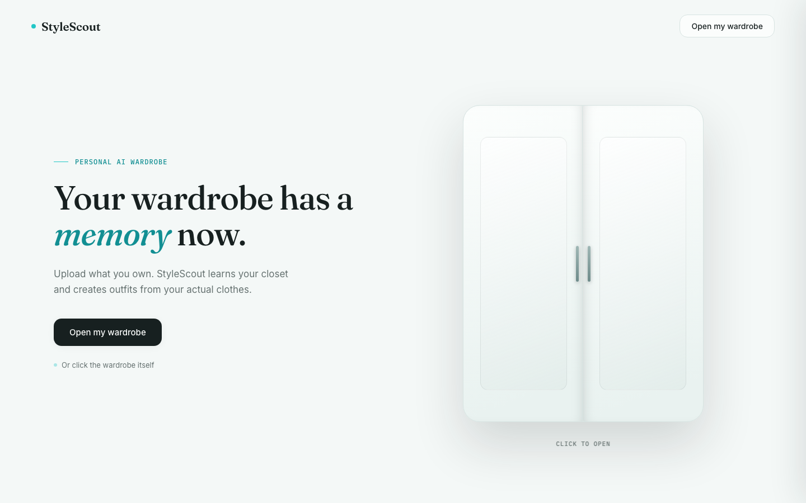
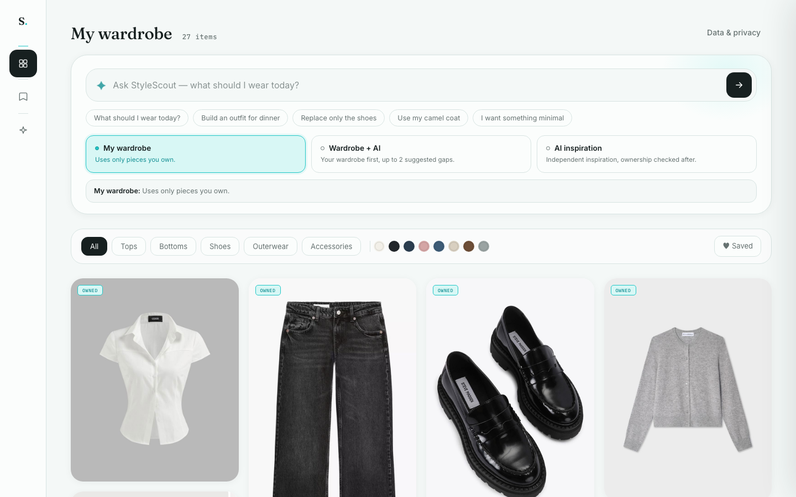
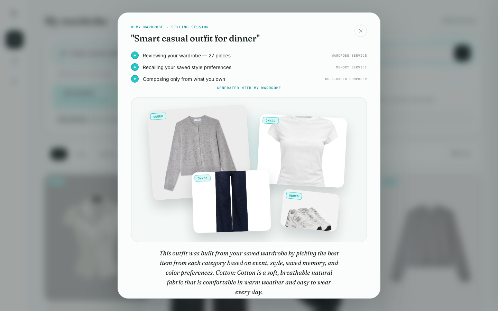
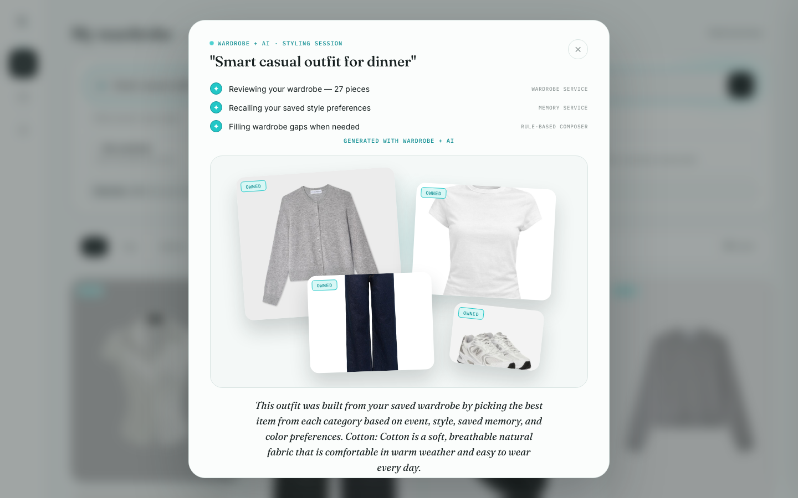
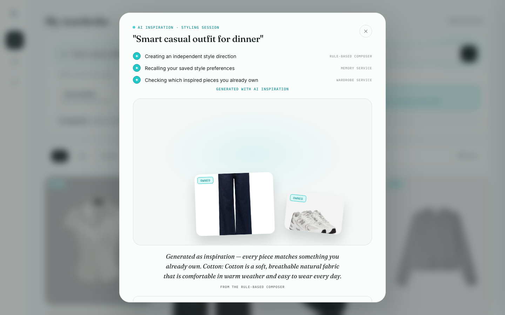

# StyleScout


StyleScout is a portfolio wardrobe assistant: you browse a personal closet, ask in plain language for an outfit, and get structured results with **owned vs suggested** provenance, a **validation gate** (schema, mode rules, repair, then deterministic fallback), and **marketplace search deep-links** (no scraped inventory or fake prices). One **FastAPI** app serves the vanilla-JS UI and JSON API. **Outfit generation is rule-based today** (`RuleBasedPlanner` + deterministic composer in `StylistAgent`, `USE_LLM=false`). **LLM planning is scaffolded** (`LLMPlanner` / OpenRouter) but **not active** on the request path unless you explicitly enable it.

**Tests:** **219 passed** (`pytest -q`) — see [`docs/test_summary.txt`](docs/test_summary.txt) for the latest local run.

---

## Screenshots

Captured at 1440×900 with **`WARDROBE_BACKEND=json`** and a normal first-visit **`sess_*`** session (same flow as a real visitor). Optional smaller demo: [`scripts/seed_portfolio_demo.py`](scripts/seed_portfolio_demo.py).

| | |
|:---:|:---:|
|  |  |
| **Landing** — open wardrobe | **Wardrobe** — filters and item grid |
|  |  |
| **Outfit — My wardrobe** (owned only) | **Outfit — Wardrobe + AI** (≤2 suggested gaps) |
|  | |
| **Outfit — AI inspiration** (catalogue + ownership check) | |

Regenerate:

```bash
pip install playwright && playwright install chromium
python scripts/take_screenshots.py
```

The script copies `wardrobe/wardrobe.json` into `data/screenshot_runtime/` (gitignored), starts a temporary server, and captures PNGs so `sess_*` rows are never written to the committed seed file.

---

## Tech stack

| Layer | Choice |
|-------|--------|
| API | **FastAPI** + **Uvicorn** |
| Frontend | **Vanilla HTML/CSS/JS** (served as static files from `frontend/`) |
| Persistence | **SQLite** (Docker / optional local demo) or **JSON** (`wardrobe/wardrobe.json`) |
| Validation | **Pydantic** models + `OutfitValidator` (repair → rule-based fallback) |
| Agents | **StylistAgent**, **InlineEditAgent** (orchestrator); everything else is a service |
| Tests | **pytest** + Starlette TestClient (`httpx2`) |
| Deploy | **Docker** (`python:3.11-slim`) on Render |

There is **no Next.js** and **no PostgreSQL** in this repo.

---

## Run locally

### 1. Backend + UI (recommended for development)

```bash
cd fashion-agent
python3 -m venv .venv && source .venv/bin/activate   # optional
pip install -r requirements.txt
cp .env.example .env                                 # do not commit .env
uvicorn api.main:app --reload --host 127.0.0.1 --port 8000
```

Open **http://127.0.0.1:8000**. The app serves `frontend/index.html` and the API on the same origin.

Default `.env` uses `WARDROBE_BACKEND=json` and the committed sample wardrobe in `wardrobe/wardrobe.json`. New browser sessions get a `stylescout_session` cookie and a copy of the sample closet when empty.

### 2. Optional portfolio demo DB (~15 fictional items)

For a smaller isolated closet (not your `wardrobe/wardrobe.json`):

```bash
python3 scripts/seed_portfolio_demo.py
ALLOW_DEFAULT_OVERRIDE=true WARDROBE_BACKEND=sqlite DB_PATH=data/portfolio_demo.db \
  uvicorn api.main:app --host 127.0.0.1 --port 8000
```

Use cookie `stylescout_session=default` in API clients (local only; **never** enable `ALLOW_DEFAULT_OVERRIDE` on a public host). Verify outfits:

```bash
curl -s -H 'Cookie: stylescout_session=default' \
  -H 'Content-Type: application/json' \
  -d '{"prompt":"casual dinner","mode":"my_wardrobe"}' \
  http://127.0.0.1:8000/api/outfits
```

All three modes (`my_wardrobe`, `wardrobe_plus_ai`, `ai_inspiration`) work **without** an OpenRouter key while `USE_LLM=false`.

### 3. Docker (matches production)

```bash
docker build -t stylescout .
docker run -p 8000:8000 -e PORT=8000 stylescout
```

Open http://localhost:8000. Image uses SQLite at `/app/data/wardrobe.db` and `HEALTHCHECK` on `GET /health`.

### Tests

```bash
pytest -q
```

---

## What it does (60 seconds)

1. **Wardrobe** — Browse items scoped to an anonymous browser session (`sess_<uuid>` cookie).
2. **Outfit generation** — Natural-language prompt → rule-based composer → validation gate → JSON with provenance badges.
3. **Three modes:**
   - **My wardrobe** — owned pieces only.
   - **Wardrobe + AI** — mostly owned; up to **two** suggested catalogue items with shopping search links.
   - **AI inspiration** — catalogue outfit, then ownership resolver marks pieces you already own.
4. **Inline edit** — Free-text swap on one board slot (keyword rules).
5. **Transparency** — Owned/suggested badges, validation notices, grounded explanation bullets (no numeric “AI scores”).

Architecture: [`docs/ARCHITECTURE.md`](docs/ARCHITECTURE.md) · API: [`docs/API_SPEC.md`](docs/API_SPEC.md) · Data: [`docs/DATA_MODEL.md`](docs/DATA_MODEL.md)

---

## Deterministic vs LLM (today)

| Layer | Production behavior |
|-------|---------------------|
| Planning | **RuleBasedPlanner** keyword rules (`USE_LLM=False`) |
| Outfit composition | **Deterministic** scorer + catalogue fallback in `StylistAgent` |
| Validation | **OutfitValidator** — schema, mode caps, repair, MY_WARDROBE fallback |
| Inline edit | **Keyword matching** (`inline_edit_config.py`) |
| Shopping | **SearchSpec → Vinted catalog URL** (no scraping, no prices) |
| LLM | **`LLMPlanner` scaffolded**; **`llm_client.py` not on request path** |

Full boundary table: [`docs/ARCHITECTURE.md#deterministic-vs-llm-boundary`](docs/ARCHITECTURE.md#deterministic-vs-llm-boundary)

---

## What this does not do

Honest limits (see `docs/DECISIONS.md` “Known gap” rows for provenance):

- **No authentication** — anonymous session cookie only; not suitable as multi-tenant production auth.
- **No LLM in the live path** — despite “AI” mode names, composition is rule-based today.
- **No real-time inventory or pricing** — suggested items link to public marketplace **searches**, not product APIs.
- **No learned personalization** — style memory is keyword-based global JSON, not per-user ML.
- **Ephemeral hosting** — on free-tier PaaS without a persistent disk, SQLite/JSON data may not survive redeploy or cold start (see below).
- **Global style memory** — `memory/memory_store.json` is shared, not scoped per session.
- **SQLite provenance alignment (SCOUT-002 sub-task C)** — JSON vs SQLite `source`/`owned` persistence parity not fully closed.
- **Inline edit bypasses validation gate** — `POST /api/outfits/inline-edit` does not run `OutfitValidator` (documented deferred gap).
- **Partial shopping profile** — only `max_price` and `size`; currency/country/exclusions deferred (SCOUT-008/009 follow-up).

---

## Thesis (non-commercial demo)

This project is a **portfolio piece**, not a commercial product. It deliberately rejects fake product catalogs, scraped inventory, and affiliate APIs (see SCOUT-010 in `docs/DECISIONS.md`).

The design thesis: turn a styling opinion into a **structured, legal, scraping-free `SearchSpec`** and a **deep link to a real marketplace search** — defensible output without pretending to know stock or price. There is **no monetization model** implemented; no affiliate tracking, no paid tiers, no product margin.

---

## Deployment & Limits

### Cold start

On free-tier PaaS hosts (e.g. Render), the service may **spin down after inactivity**. The first request after idle can take **30–60+ seconds** while the container starts. Retry once if the UI or API appears unavailable — this is platform behavior, not an application bug.

Health endpoints (no orchestrator or database work):

- `GET /health`
- `GET /api/health`

Both return `{"status":"ok","version":"0.1.0"}`.

### Ephemeral filesystem

Docker production uses SQLite at `/app/data/wardrobe.db` (see `Dockerfile`). That file **survives restarts within the same container instance** but is **not guaranteed across redeploys or cold starts** unless the host attaches a persistent disk.

On startup (`lifespan` → `seed_wardrobe_if_empty`):

- When `WARDROBE_BACKEND=sqlite`, the app creates the `DB_PATH` parent directory if missing, initializes schema, and **idempotently seeds** the default sample wardrobe when the table is empty.
- New session users (`sess_<uuid>`) receive a per-user wardrobe copy on first access when their wardrobe is empty.

**Session cookies** survive in the browser; **server-side wardrobe, saved outfits, and preferences may not** after redeploy without persistent storage. Style memory (`memory/memory_store.json`) is a single global file — same ephemeral risk.

### Environment variables

Copy `.env.example` for local dev. Production Docker overrides backend/path in the `Dockerfile`; cloud hosts inject `PORT`.

| Variable | Default (local) | Purpose |
|----------|-----------------|---------|
| `PORT` | `8000` | Uvicorn listen port (`${PORT:-8000}` in Docker CMD) |
| `WARDROBE_BACKEND` | `json` | `json` (local) or `sqlite` (Docker / production) |
| `DB_PATH` | `wardrobe/wardrobe.db` | SQLite file when `WARDROBE_BACKEND=sqlite` |
| `WARDROBE_JSON_PATH` | `wardrobe/wardrobe.json` | JSON wardrobe file when backend is `json` |
| `SAVED_OUTFITS_JSON_PATH` | `wardrobe/saved_outfits.json` | Saved outfit history (JSON backend) |
| `PREFERENCES_JSON_PATH` | `wardrobe/preferences.json` | Per-user shopping prefs |
| `OPENROUTER_API_KEY` | *(unset)* | Optional LLM key; unused in live path (`USE_LLM=False`) |
| `ALLOW_DEFAULT_OVERRIDE` | `false` | **`false` or unset in any public deployment** |

`memory/memory_store.json` is not env-configurable.

### Public deployment safety

Set **`ALLOW_DEFAULT_OVERRIDE=false`** (or leave unset) on any public host. When `true`, the guessable cookie `stylescout_session=default` exposes legacy demo data — gated for local manual testing only.

---

## Documentation map

| Doc | Audience | Contents |
|-----|----------|----------|
| [`docs/ARCHITECTURE.md`](docs/ARCHITECTURE.md) | Reviewers | Component + sequence diagrams, mode paths, LLM boundary |
| [`docs/API_SPEC.md`](docs/API_SPEC.md) | Reviewers | Every HTTP endpoint and field shapes |
| [`docs/DATA_MODEL.md`](docs/DATA_MODEL.md) | Reviewers | Pydantic models, provenance contract, persistence |
| [`docs/DECISIONS.md`](docs/DECISIONS.md) | Maintainers | Architecture decision records |
| `AGENTS.md` | AI/dev process | Product contract and hard rules (internal) |
| `docs/AUDIT.md`, `docs/BACKLOG.md` | Internal | Audit snapshot and ticket backlog |

---

## Persistence (anonymous sessions)

Each browser gets an httpOnly `stylescout_session` cookie (`sess_<uuid>`). That value is used as `user_id` for wardrobe items and saved outfits, so returning visitors see their data after refresh **in the same browser** — subject to ephemeral storage limits above.

No login or accounts in MVP.
